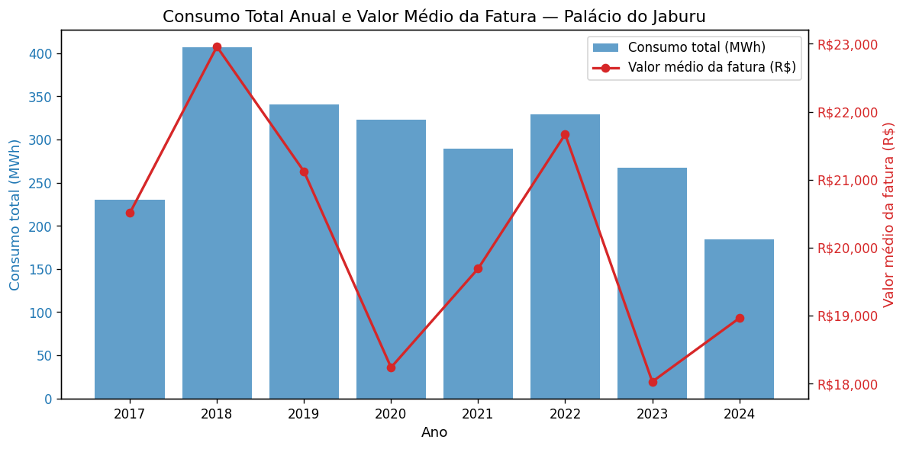
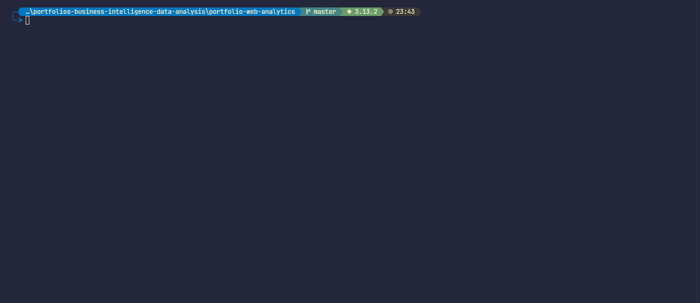

# Portfólios de Business Intelligence e Análise de Dados

Trabalhos práticos que fiz no curso superior de tecnologia em Inteligência de Mercado e Análise de Dados, da Anhanguera. Cada pasta é um projeto independente, com o código, as instruções para rodar e o relatório entregue.

| Projeto | Disciplina | O que faz | Ferramentas |
| --- | --- | --- | --- |
| [Bancos de dados não relacionais](portfolio-nosql-database) | Bancos de Dados Não Relacionais | Modela clientes e compras como documentos no MongoDB e responde cinco consultas | MongoDB, Docker, Python |
| [Consumo de energia no Palácio do Jaburu](portfolio-visualizacao-de-dados-e-storytelling) | Visualização de Dados e Storytelling | Conta em gráficos sete anos de consumo de energia e gera o relatório por script | Python, pandas, matplotlib, Plotly, python-docx |
| [Goodreads e Kaggle num só registro](portfolio-web-analytics) | Web Analytics | Raspa a página de um mangá no Goodreads, cruza com um dataset do Kaggle e grava um JSON | Python, httpx, BeautifulSoup, pandas, kagglehub |

## Bancos de dados não relacionais

Banco `lojadb` com três clientes, cada um num documento com telefones, endereço e compras aninhados. O MongoDB roda em Docker e o relatório em PDF sai de um script que converte o Markdown.

## Consumo de energia no Palácio do Jaburu

88 meses de consumo entre 2017 e 2024: a queda ao longo dos anos, o pico de setembro a novembro e a relação entre consumo e valor da fatura (r = 0,624).

## Goodreads e Kaggle num só registro

Pipeline em Python com configuração em YAML: busca, download com cache, extração por seletores e junção das duas fontes.

## Como rodar

Cada projeto tem o passo a passo no próprio README. Em comum:

- Os projetos de NoSQL e de Web Analytics usam Python 3.13 com [uv](https://docs.astral.sh/uv/); o de Visualização usa `pip` e `requirements.txt`.
- O de NoSQL precisa de [Docker](https://docs.docker.com/get-docker/) para o MongoDB.
- Dados baixados ou gerados na execução ficam fora do git. O `.gitignore` da raiz vale para todos os projetos.

Projetos novos entram numa pasta `portfolio-<disciplina>`.

## Contato

[GitHub](https://github.com/pagueru/) · [LinkedIn](https://www.linkedin.com/in/raphaelhvcoelho/) · [raphael.phael@gmail.com](mailto:raphael.phael@gmail.com)
