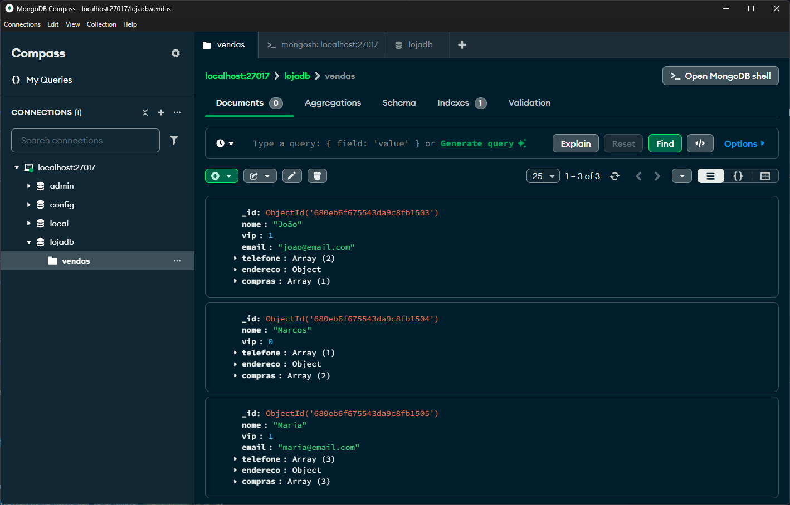
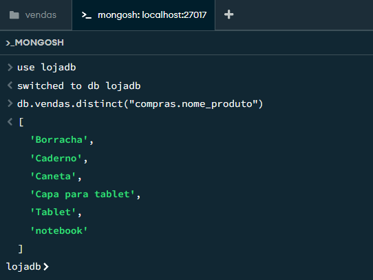

# Bancos de dados não relacionais com MongoDB

Aula prática da disciplina Bancos de Dados Não Relacionais (5º semestre, 2025). Criei o banco `lojadb`, cadastrei três clientes na coleção `vendas`, completei os documentos com endereço e histórico de compras e respondi as cinco consultas pedidas no roteiro.



## O que tem aqui

| Arquivo | Conteúdo |
| --- | --- |
| [RELATORIO.md](RELATORIO.md) | Relatório completo: cada comando, os prints do Compass e a conclusão |
| [docs/relatorio-aula-pratica.pdf](docs/relatorio-aula-pratica.pdf) | O mesmo relatório em PDF, a versão entregue |
| [docs/roteiro-aula-pratica.pdf](docs/roteiro-aula-pratica.pdf) | Roteiro da aula prática, da faculdade |
| [queries/](queries) | Os 12 comandos do relatório em arquivos `.js`, prontos para rodar no `mongosh` |

## Modelo de dados

Cada cliente é um documento só. Telefones ficam num array, o endereço num objeto aninhado e as compras num array de objetos, sem tabela de junção:

```javascript
{
  nome: "Maria",
  vip: 1,
  email: "maria@email.com",
  telefone: ["9999-3333", "8888-3333", "9988-3000"],
  endereco: { rua: "Rua Três", numero: 3000, cidade: "Londrina", estado: "PR" },
  compras: [
    { nome_produto: "Tablet", preco: 2500.00, quantidade: 1 },
    { nome_produto: "Capa para tablet", preco: 50.00, quantidade: 1 }
  ]
}
```

O documento completo da Maria tem três compras; o trecho acima mostra duas.

## As cinco consultas

| Pergunta | Consulta |
| --- | --- |
| Quais são os dados da cliente Maria? | `db.vendas.find({ "nome": "Maria" })` |
| Quem são os clientes VIP? | `db.vendas.find({ "vip": 1 }, { "nome": 1, "_id": 0 })` |
| O que o Marcos comprou? | `db.vendas.find({ "nome": "Marcos" }, { "compras": 1, "_id": 0 })` |
| Quais produtos foram vendidos, sem repetição? | `db.vendas.distinct("compras.nome_produto")` |
| Como ficou a coleção inteira? | `db.vendas.find()` |

A consulta de produtos distintos entra dentro do array de compras de cada cliente e devolve a lista única:



Os prints das outras consultas estão no [relatório](RELATORIO.md#23-processamento-de-dados-procedimentoatividade--2).

## Como reproduzir

Precisa de [Docker](https://docs.docker.com/get-docker/). Os comandos rodam a partir desta pasta.

1. Copie `.env.example` para `.env` e troque a senha.
2. Suba o MongoDB 6.0 e o mongo-express:

   ```bash
   docker compose up -d
   ```

   Na primeira subida o Mongo cria o usuário e reinicia; espere uns 30 segundos antes do próximo passo. Os dados ficam em `mongo-data/`, fora do git.

3. Rode os comandos de `queries/` na ordem do relatório: o `insertMany`, as três atualizações de endereço, as três de compras e depois as consultas. Com a senha do `.env` no lugar de `<senha>`:

   ```bash
   docker exec -i mongo-db mongosh --quiet "mongodb://admin:<senha>@localhost:27017/lojadb?authSource=admin" < queries/db-vendas-insertMany.js
   ```

4. Para navegar pelos documentos, abra o mongo-express em <http://localhost:8081> (login padrão da imagem: `admin` / `pass`) ou conecte o MongoDB Compass em `mongodb://admin:<senha>@localhost:27017`.
5. Para apagar tudo: `docker compose down -v` e esvazie `mongo-data/`.

O `Makefile` tem atalhos para os mesmos passos (`make help` lista todos).

## Como o relatório é gerado

O relatório foi escrito em Markdown e convertido em PDF por um script próprio. O `main.py` abre um menu com duas opções:

1. Extrair os blocos de código JavaScript do `RELATORIO.md` para `queries/`.
2. Converter o `RELATORIO.md` em HTML com o [pandoc](https://pandoc.org/installing.html) e o HTML em PDF com o [WeasyPrint](https://doc.courtbouillon.org/weasyprint/stable/first_steps.html), usando o estilo de `css/`.

```bash
uv sync --all-extras
uv run python main.py
```

A opção 2 precisa do pandoc instalado e, no Windows, das bibliotecas do WeasyPrint. O projeto usa Python 3.13 e [uv](https://docs.astral.sh/uv/).

## Estrutura

```text
portfolio-nosql-database/
├── RELATORIO.md         # relatório (fonte do PDF)
├── main.py              # menu: extrai consultas e gera o PDF
├── src/                 # extrator de blocos de código e conversor Markdown → PDF
├── queries/             # comandos do relatório, um por arquivo
├── images/              # prints do MongoDB Compass usados no relatório
├── css/                 # estilo do PDF
├── docs/                # relatório em PDF e roteiro da aula
├── docker-compose.yml   # MongoDB 6.0 e mongo-express
└── .env.example         # usuário e senha do Mongo
```
