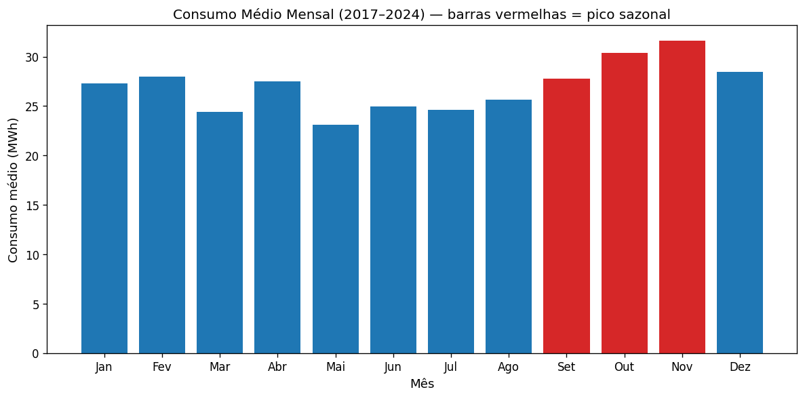
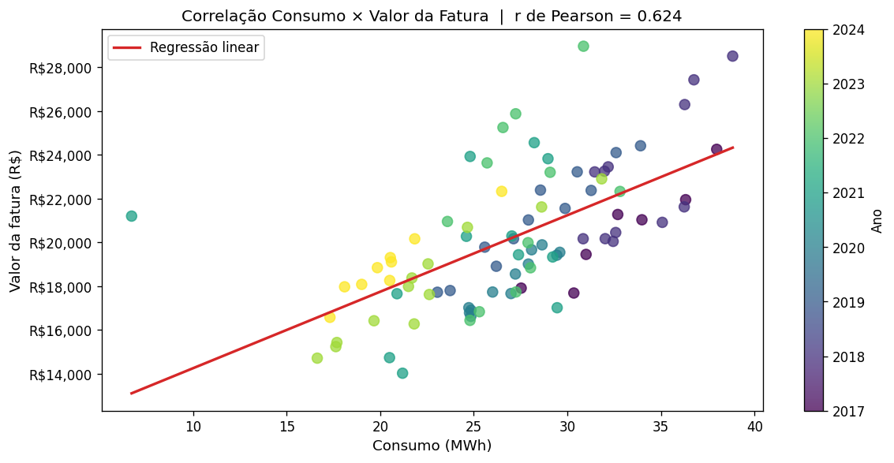

# Consumo de energia no Palácio do Jaburu

Atividade textual da disciplina Visualização de Dados e Storytelling. A pergunta era como contar, com gráficos, a história do consumo de energia elétrica da residência oficial do vice-presidente entre junho de 2017 e setembro de 2024. Um script baixa os dados, gera os gráficos e monta o relatório em `.docx`.


O relatório entregue está em [PDF](outputs/Visualizacao_de_Dados_e_storytelling_Raphael_Henrique_Vieira_Coelho.pdf) e em [Word](outputs/Visualizacao_de_Dados_e_storytelling_Raphael_Henrique_Vieira_Coelho.docx).

## O que os dados mostram

- O consumo caiu ao longo do período. As quedas anuais maiores foram em 2023 (-18,9%), 2019 (-16,3%) e 2021 (-10,6%); 2024 aparece com -31,0%, mas a série vai só até setembro.
- Setembro, outubro e novembro concentram o maior consumo médio, com pico em novembro (31,6 MWh). Em Brasília a primavera é o começo do calor, quando o ar-condicionado pesa mais.
- Consumo e valor da fatura têm correlação positiva moderada (r de Pearson = 0,624): a conta acompanha o consumo, mas reajustes de tarifa também pesam.

A ligação com a pandemia e com reajustes tarifários é leitura do relatório, não algo que o script testa.

## Gráficos

<table>
  <tr>
    <td width="50%"></td>
    <td width="50%"></td>
  </tr>
  <tr>
    <td>Consumo médio por mês do ano, de 2017 a 2024. As barras em vermelho marcam setembro a novembro.</td>
    <td>Consumo contra valor da fatura, um ponto por mês, com cor por ano e o r de Pearson no título.</td>
  </tr>
</table>

O relatório tem ainda um gráfico interativo em Plotly do consumo mensal por ano. O script grava o `.html` em `outputs/`, fora do git; a [prévia estática](outputs/fig_interativo_preview.png) fica versionada.

## Dados

São 88 registros mensais com o consumo em kWh e o valor bruto da fatura, do CSV público usado no material da disciplina. O endereço está em [`src/load_data.py`](src/load_data.py); o script baixa o arquivo na primeira execução e guarda uma cópia em `data/`, fora do git; para baixar de novo, apague essa pasta.

## Como gerar de novo

Precisa de Python 3 e acesso à internet para baixar o CSV.

```bash
pip install -r requirements.txt
python src/build_docx.py
```

O script refaz os gráficos em `outputs/`, calcula a correlação e grava o `.docx` por cima do entregue. O PDF não sai do script: foi exportado do Word.

## Estrutura

```text
portfolio-visualizacao-de-dados-e-storytelling/
├── src/
│   ├── load_data.py    # baixa e limpa o CSV (mês por extenso, valor em reais)
│   ├── plots.py        # os quatro gráficos, em matplotlib e Plotly
│   └── build_docx.py   # monta o relatório com python-docx
├── outputs/            # gráficos e relatório entregue (.docx e .pdf)
└── requirements.txt
```
